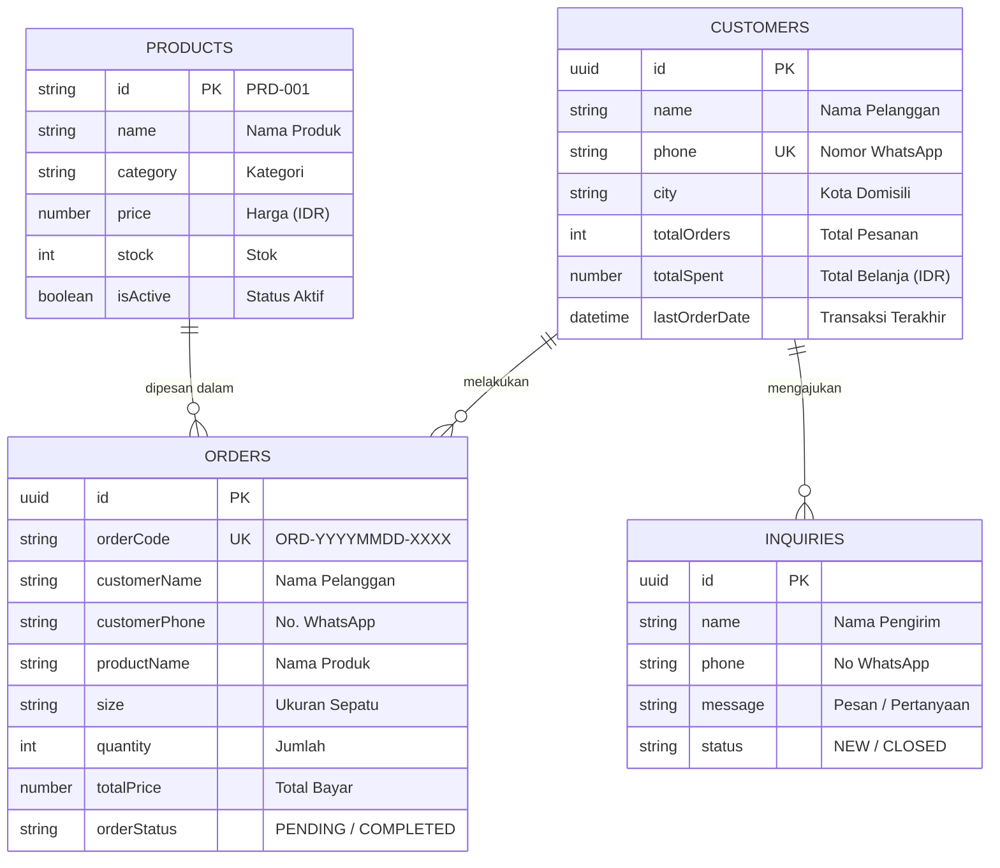

# ⚽ LocalMart — Sepatu Futsal & Minisoccer Jakarta

> **"Gesit Terus, Main Makin Puas!"**  
> Toko online modern penyedia sepatu futsal, minisoccer, dan aksesoris olahraga pilihan di Jakarta dengan integrasi pemesanan WhatsApp langsung dan dukungan **Dual Database (Supabase PostgreSQL & Google Sheets via Apps Script)**.

🌐 **Live Demo Website:** [https://alfiandi07-localmart-shop-boost.alfiandisha.workers.dev](https://alfiandi07-localmart-shop-boost.alfiandisha.workers.dev)

---

## 🚀 Fitur Utama

- **⚡ Fast & Modern Storefront:** Dibangun menggunakan TanStack Start (SSR) dan React 19 untuk performa kilat dan SEO optimal.
- **📱 Mobile-First Responsive Design:** Desain khusus yang responsif dari layar smartphone (375px) hingga desktop widescreen.
- **💬 Seamless WhatsApp Integration:** Tombol WhatsApp mengambang (*sticky button*) di tampilan mobile dan draf pesan pesanan otomatis.
- **📋 Formulir Pesanan Real-time:** 
  - Input nama, nomor WhatsApp, pilihan produk, ukuran (*size*), jumlah beli, dan catatan alamat.
  - Auto-generate kode pesanan unik (contoh: `ORD-20261013-1042`).
  - Indikator loading dan notifikasi status pengiriman.
- **🗄️ Dual Database Backend Architecture:**
  - **Supabase (PostgreSQL):** Penyimpanan transaksi relasional, Row Level Security (RLS), dan trigger otomatis update akumulasi belanja pelanggan (*CRM*).
  - **Google Sheets (Apps Script):** Pencatatan otomatis ke lembar kerja spreadsheet tanpa perlu login akun Google.
- **☁️ Cloudflare Workers Deployment:** Di-deploy sebagai serverless worker global dengan latensi ultra-rendah melalui Nitro & Cloudflare.

---

## 🛠️ Tech Stack

| Kategori | Teknologi |
|---|---|
| **Framework** | [TanStack Start](https://tanstack.com/start) & [React 19](https://react.dev) |
| **Routing** | [TanStack Router](https://tanstack.com/router) |
| **Bahasa** | [TypeScript](https://www.typescriptlang.org/) |
| **Styling** | [Tailwind CSS v4](https://tailwindcss.com/) & Vanilla CSS Design Tokens |
| **Komponen & Ikon** | [Radix UI Primitives](https://www.radix-ui.com/), [Lucide React](https://lucide.dev) |
| **Validasi Skema** | [Zod](https://zod.dev) |
| **Database Utama** | [Supabase](https://supabase.com) (PostgreSQL) |
| **Database Spreadsheet** | Google Sheets + [Google Apps Script](https://developers.google.com/apps-script) Web App |
| **Server & Hosting** | [Cloudflare Workers](https://workers.cloudflare.com/) via Wrangler & Nitro Engine |
| **Testing** | [Vitest](https://vitest.dev) |

---

## 📊 Struktur Entitas Database

Database LocalMart memiliki 4 entitas utama:



---

## 📁 Struktur Direktori Proyek

```text
localmart-shop-boost/
├── google-apps-script/
│   └── Code.gs                  # Skrip backend Google Sheets Apps Script API
├── supabase/
│   └── schema.sql               # Skrip SQL tabel, trigger CRM, RLS, & seed data
├── src/
│   ├── assets/                  # Foto produk, logo, dan aset visual
│   ├── components/
│   │   ├── storefront/
│   │   │   └── sections.tsx     # Hero, Navbar, Products, OrderForm, Footer
│   │   └── ui/                  # Komponen UI Button, Accordion, dll.
│   ├── lib/
│   │   ├── google-sheets.ts     # Client helper Google Apps Script
│   │   ├── supabase.ts          # Client helper Supabase SDK
│   │   ├── storefront.ts        # Katalog produk & data FAQ statis
│   │   └── utils.ts             # Utility functions
│   ├── routes/
│   │   ├── __root.tsx           # Layout root TanStack Router
│   │   └── index.tsx            # Halaman utama landing page
│   ├── types/
│   │   └── database.ts          # TypeScript interfaces & Zod schemas
│   ├── styles.css               # Styling tema, design tokens, & responsif
│   └── server.ts                # Server entry SSR
├── .env.example                 # Template variabel lingkungan
├── package.json                 # Skrip proyek & dependensi
└── vite.config.ts               # Konfigurasi Vite & TanStack Start
```

---

## 💻 Panduan Instalasi Lokal

### 1. Clone Repositori
```bash
git clone https://github.com/alfiandi07/localmart-shop-boost.git
cd localmart-shop-boost
```

### 2. Pasang Dependensi
```bash
npm install
```

### 3. Konfigurasi Lingkungan (`.env`)
Salin file `.env.example` menjadi `.env`:
```bash
cp .env.example .env
```
Isi variabel dengan kredensial Anda:
```env
# Google Apps Script Web App Endpoint
VITE_GOOGLE_APPS_SCRIPT_URL=https://script.google.com/macros/s/AKfycbzTAeSx_AbO37PLeM0rxQ1oeSWro7O-9IvUe5faI64iQtQWHtJXMoZUWgC-bgK6PDbn/exec

# Supabase Project
VITE_SUPABASE_URL=https://omxadxkqlvptlvruvhco.supabase.co
VITE_SUPABASE_ANON_KEY=eyJhbGciOiJIUzI1NiIsInR5cCI6IkpXVCJ9...
```

### 4. Jalankan Server Pengembangan
```bash
npm run dev
```
Buka [http://localhost:5173](http://localhost:5173) di browser Anda.

---

## 🗃️ Pengaturan Database

### A. Pengaturan Supabase
1. Buka [Supabase Dashboard](https://supabase.com/dashboard/project/omxadxkqlvptlvruvhco).
2. Masuk ke menu **SQL Editor** > **New query**.
3. Salin seluruh isi file [`supabase/schema.sql`](supabase/schema.sql) dan jalankan (**Run**).

### B. Pengaturan Google Sheets (Apps Script)
1. Buka Google Sheets > **Extensions** > **Apps Script**.
2. Salin isi file [`google-apps-script/Code.gs`](google-apps-script/Code.gs) ke editor.
3. Jalankan fungsi `setupDatabase` atau `setupCustomersTable` untuk inisialisasi tabel otomatis.
4. Klik **Deploy** > **Manage deployments** > atur **Who has access** ke **`Anyone`**.

---

## 🚢 Pengujian & Deployment

### Menjalankan Unit Test
```bash
npm run test
```

### Build & Deploy ke Cloudflare Workers
```bash
npm run deploy
```

---

## 📞 Kontak & Informasi Toko

* **Toko:** LocalMart
* **Alamat:** Jl. Kemayoran Ketapang, Jakarta Pusat, Jakarta
* **WhatsApp:** [0896-5291-4048](https://wa.me/6289652914048)
* **Instagram:** [@Sportevo](https://instagram.com/Sportevo)
* **Tahun:** © 2026 LocalMart
